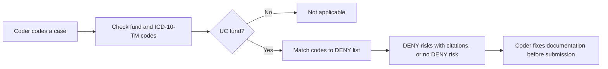

# Intent Backlog: 2026 NHSO DENY-list checker

Upstream: `aidlc/spaces/default/intents/261022-deny-list-checker/ideation/intent-capture/intent-statement.md`, `aidlc/spaces/default/intents/261022-deny-list-checker/ideation/feasibility/feasibility-assessment.md`, `aidlc/spaces/default/intents/261022-deny-list-checker/ideation/feasibility/constraint-register.md`.

## Prioritized Backlog (MoSCoW, in build order)

| # | Item | MoSCoW | Depends on | Value |
|---|------|--------|------------|-------|
| IB-1 | Walking skeleton: CR1 sepsis (A40-A41) through load, check, HTTP API and a test for GT-001 | Must | None | Proves the whole path end to end early in the time box (Q2) |
| IB-2 | Load every seed-list row with its source row | Must | IB-1 | All 10 DENY codes available for checking (intent statement) |
| IB-3 | ICD code and range matching for all entry shapes (range, single code, list) | Must | IB-2 | Correct matches such as A41.9 inside A40-A41 (intent statement) |
| IB-4 | UC-only rule and "not applicable" for SSO, CSMBS and private | Must | IB-1 | Covers GT-002 and the non-UC metric (intent statement) |
| IB-5 | Citation on every finding (DENY code and source row) | Must | IB-2 | Auditable findings (intent statement) |
| IB-6 | Tests from all sample cases ("expected code contained in findings") | Must | IB-3, IB-4, IB-5 | 100% of sample cases pass (intent statement) |
| IB-7 | Batch check of several cases for auditors | Could | IB-6 | Auditors review many cases at once (Q1) |
| IB-8 | Excel reading for the official list | Won't (this time) | — | Added when the file arrives (constraint register C-T4) |
| IB-9 | Stricter criteria text on findings | Won't (this time) | — | Open question (intent statement) |

## Value Stream

<!-- Text fallback: The coder codes a case, the checker looks at its fund and ICD-10-TM codes. A non-UC fund returns not applicable. A UC fund is matched against the DENY list, returning DENY risks with citations or no DENY risk, so the coder can fix the documentation before submitting the claim. -->
